# 🧠 selfaware

A Claude Code skill that gives Claude **real-time awareness of its own API usage** and the logic to manage it: hooks check usage automatically each session/turn, Claude offloads suitable work to Codex when usage gets high, checkpoints to `TASK_STATE.md` before limits hit, and resumes after the window resets.

A self-contained skill folder (`SKILL.md` + bundled scripts), auto-discovered from `~/.claude/skills/`. Usage checks run through Claude Code **hooks**, so there's nothing to remember to call.



## Why This Exists

Claude Code runs on rolling usage windows — a 5-hour limit and a weekly one. Hit one mid-task and the session stops cold: you lose flow, and worse, work can be left half-finished with no record of where it was. Out of the box Claude has **no awareness of its own usage**, so it can't see the wall coming or plan around it.

`selfaware` closes that gap. It gives Claude a live read on its remaining capacity and the logic to act on it *before* the limit hits:

- **See it coming** — hooks check usage every turn, silently, and surface a directive only when it matters.
- **Stretch the budget** — at 80%+, hand independent work to Codex instead of burning Claude tokens.
- **Never lose work** — at 90%, checkpoint to `TASK_STATE.md` and stop with a buffer.
- **Resume unattended** — after the window resets, pick up exactly where it left off (the marathon above).

The payoff: long refactors, agentic runs, and overnight marathons survive limit resets without you babysitting the session.

## Behavior

The hooks inject a directive only when there's something to do; below WARNING they stay silent.

| Status | Trigger | Action |
|--------|---------|--------|
| `OK` | 5h < 60% & 7d < 70% | Full speed, usage invisible to user |
| `MODERATE` | 5h ≥ 60% or 7d ≥ 70% | Work normally, stay efficient |
| `WARNING` | 5h ≥ 80% or 7d ≥ 80% | Delegate suitable tasks to Codex (if available); tell user once |
| `CRITICAL` | 5h ≥ 90% or 7d ≥ 90% | Write `TASK_STATE.md`, stop, keep buffer |
| `CRITICAL_BUFFER` | 5h ≥ 90% **and** resets ≤30 min **and** 7d < 90% | Push through the buffer; keep checkpoint ready |
| `UNKNOWN` | token/API failure | Fail open — proceed; inject nothing |

At 80%+ Claude routes independent, verifiable work (boilerplate, tests, mechanical refactors, docs) to Codex — keeping architecture, context-dependent, and security-sensitive work for itself — and always verifies Codex output before building on it.

## The three pieces

1. **Usage hooks** — `SessionStart` (resume a `TASK_STATE.md` checkpoint + first check) and `UserPromptSubmit` (re-check before every reply). Inform-only: they never block your message, and inject a directive only at WARNING+.
2. **launchd keep-alive** — a 5-hourly tiny ping that keeps usage windows warm, via a launchd agent that **survives sleep and reboot** (cron can't). Skips when usage is already > 70%. Separate Claude / Codex toggles; Codex is probed first and disabled if it fails.
3. **`claude-m` marathon** — launches Claude in a tagged tmux session. A single shared daemon watches all `claude-m` sessions, tells them to checkpoint + pause at the 5-hour limit, and nudges them to continue after reset.

## Install

```bash
cd claude-selfaware
./install.sh
```

The installer copies the skill to `~/.claude/skills/selfaware/`, symlinks `claude-m` into `~/.local/bin`, installs `/selfaware-usage-info`, `/selfaware-test`, and `/selfaware-task-update`, runs a real Codex probe, asks where to install the hooks (global / project / skip), and optionally sets up the launchd keep-alive (Claude and/or Codex).

After installing, run `/selfaware-test` (or `~/.claude/skills/selfaware/scripts/selftest.sh`) to cross-check every layer — deps, hooks, live usage API, band logic, Codex, the launchd timer, and `claude-m` — in one pass.

## Usage

- **Automatic** — hooks check usage each session and turn. Nothing to run.
- `/selfaware-usage-info` — manual status summary inside a session.
- `/selfaware-test` — full health check (deps, hooks, API, band logic, Codex, launchd timer, marathon). Add `codex` to also run a real delegation.
- `/selfaware-task-update` — write/update `TASK_STATE.md` on demand mid-session (manual checkpoint).
- `claude-m [name] [task...]` — start a marathon tmux session that auto-resumes after a reset. The first word names the session (`claude-m sorbh`), any following words are an initial prompt (`claude-m sorbh fix the parser`); `-n`/`-p` set them explicitly.
- `~/.claude/skills/selfaware/scripts/usage-info.sh refresh` — visual dashboard (5h / 7d / Opus bars).

## Config

Override via env or edit the top of the relevant script:

- **Thresholds / buffer window** — `usage-lib.sh` (`USAGE_WARN_*`, `USAGE_CRIT_*`, `USAGE_RESET_SOON_MIN`).
- **Usage cache duration** — `USAGE_POLL_INTERVAL=120` in `usage-lib.sh` (don't drop below ~120 — endpoint rate limits).
- **Codex probe cache** — `CODEX_PROBE_TTL=86400` in `usage-lib.sh`.
- **Keep-alive skip threshold** — `SKIP_IF_ABOVE=70` in `keepalive.sh`.
- **Daemon poll / wrap-up** — `MARATHON_CHECK_INTERVAL`, `MARATHON_WRAP_AT`, `MARATHON_BUFFER_SECONDS` in `marathon-daemon.sh`.

## Requirements

macOS (Keychain, launchd), `jq`, `bc`, `python3`, Claude Code with an active Pro/Max plan. Optional: `codex` CLI (delegation + Codex keep-alive), `tmux` (for `claude-m`) — all degrade gracefully if absent.

## Notes

- The usage endpoint is **undocumented**; field names can change. Percentages only — no absolute token counts.
- Read-only and self-credentialed: your own OAuth token, on your machine, for the same read call Claude Code already makes. Don't reuse it for inference or third-party tools.
- The keep-alive **spends a little quota** by design; it's opt-in and skips above 70%. "Warming" windows is an unproven heuristic.

## Uninstall

```bash
rm -rf ~/.claude/skills/selfaware
rm -f ~/.claude/commands/selfaware-usage-info.md ~/.claude/commands/selfaware-test.md ~/.claude/commands/selfaware-task-update.md ~/.local/bin/claude-m
launchctl bootout "gui/$(id -u)/com.claudeselfaware.keepalive" 2>/dev/null
rm -f ~/Library/LaunchAgents/com.claudeselfaware.keepalive.plist
# remove the selfaware hooks block from ~/.claude/settings.json (or the project .claude/settings.json)
```

## License

MIT
